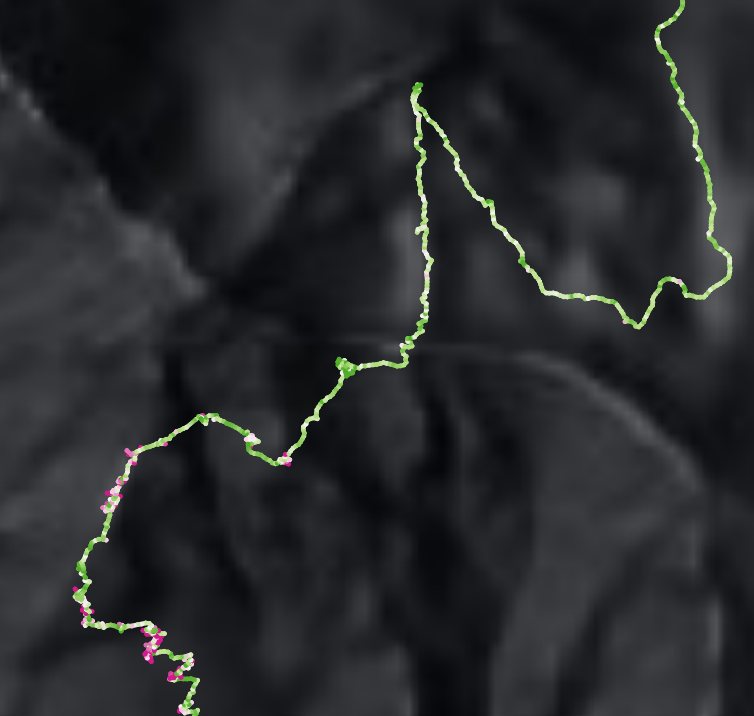
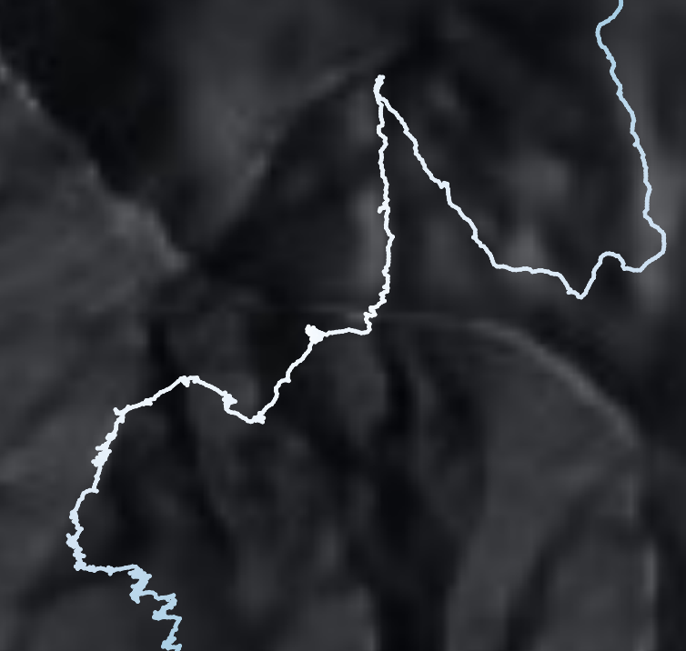
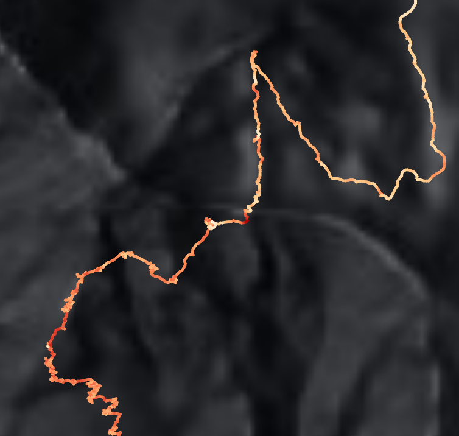

# ColorGPX

> 将 GPX 轨迹按速度、高程或坡度渲染为渐变色图层的 QGIS 插件

**ColorGPX** 从 GPX 文件的 track_points 图层中提取速度（speed）、高程（elevation）信息，并自动计算坡度（slope），生成点、线或渐变线图层，并按对应属性进行色彩渲染，让轨迹数据一目了然。

## 效果预览

| 速度渲染 (Speed) | 高程渲染 (Elevation) | 坡度渲染 (Slope) |
| :---: | :---: | :---: |
|  |  |  |

## 功能特性

- **点渲染 / 线渲染 / 渐变线渲染** — 三种模式自由切换：点模式逐点着色，线模式逐段着色，渐变线模式沿轨迹真实渐变（需 QGIS 3.40+）
- **速度 / 高程 / 坡度渲染** — 按速度、高程或坡度值自动分级，点/线模式支持 Jenks 自然断点分类，渐变线模式按字段真实最值线性映射
- **坡度计算** — 基于 Haversine 公式计算两点间水平距离与高差，使用 `atan(高差/水平距离)` 输出角度（°）。正值为上坡，负值为下坡，采用双向 EMA 平滑过渡，自动过滤 GPS 高程噪声（高差 < 0.5m 视为平地）
- **GPX Extensions 兼容** — 支持从 `<extensions>` 中读取速度和高程，兼容 Guru Maps、OsmAnd 等非标准 GPX 应用
- **色带选择** — 使用 QGIS 内置色带，带实时预览缩略图，支持滚动选择
- **反转色带** — 一键反转渐变方向
- **渐变线属性** — 自动设置内插线符号层的最小值/最大值（取 `_S`/`_E` 字段最值）、标注精度（1位）、标签单位后缀（速度→m/s，高程→m，坡度→°）
- **输出控制** — 创建临时图层或保存为 GeoJSON / GPKG / Shapefile
- **悬浮轨迹查看工具 (Hover Track Info)** — 点击工具栏的鼠标图标激活，鼠标移动到轨迹线附近时自动吸附高亮红色十字准星，显示当前吸附点的物理信息（支持 Time, Elevation, Speed, Slope）
- **动态物理插值 (Dynamic Interpolation)** — 移动到线段中点附近时自动基于投影向量比例线性内插，体现两点之间平滑过渡的真实物理参数演变
- **多投影坐标系 (CRS) 自动适配** — 内部引入 `QgsCoordinateTransform` 投影转换，保证在不同坐标系配置下定位十字准星都能紧密贴合轨迹实线
- **画布平移/缩放坐标同步** — 锁定模式下当地图被拖拽、放大、缩小时，悬浮窗与十字标会自动实时重算 Canvas 局部坐标以保持物理位置牢牢绑定
- **自适应与防后台置顶** — 悬浮窗作为 Canvas 子控件管理，在最小化 QGIS 或切换软件时自动在后台隐藏，避免顶层 ToolTip 带来的全局遮挡；且启用 Qt 尺寸限制管理器，在减少显示项时自动缩放收缩高度，杜绝空白溢出
- **实时效果预览 (Live Preview)** — 悬浮窗配置面板（齿轮图标）内右侧新增暗色圆角实时卡片预览，配置更改时即刻呈现渲染结果

## 使用方法

### 1. 轨迹渐变彩色化图层生成
1. 加载一个 GPX 文件，QGIS 会自动创建 track_points 图层
2. 点击工具栏的 **GPX → ColorGPX**（生成图标）按钮
3. 在弹出面板中：
   - 选择输入图层（GPX 的 track_points）
   - 选择渲染模式（点 / 线 / 渐变线）
   - 选择渲染字段（速度 / 高程 / 坡度）
   - 选择色带并可选反转
4. 点击 **确认运行**，渲染完成后图层自动添加到地图

### 2. 悬浮鼠标追踪与定位锁定
1. 点击工具栏的 **Hover Track Info**（鼠标图标）按钮，在弹出面板中选择要追踪的向量图层并点击开始
2. 鼠标移动至轨迹线附近，高亮红色十字星将自动吸附至轨迹线上，并悬浮显示当前的物理参数
3. **位置信息锁定**：鼠标左键点击轨迹点可锁定悬浮信息与定位标（十字星颜色由红变绿），此时即使拖动地图或滚轮缩放，悬浮窗与十字星也会随地图像素位移精确随动
4. **解锁位置锁定**：鼠标右键点击地图任意位置，或左键点击地图空白区域，即可解除当前锁定
5. 点击工具栏的 **Hover Settings**（齿轮图标）按钮可配置悬浮显示的字段项与度量单位（支持实时效果预览）

## 兼容性

| 项目 | 要求 |
|------|------|
| QGIS | 3.1+（点/线模式）· 3.40+（渐变线模式）|
| Python | 3.x |
| 依赖 | 仅使用 QGIS / PyQt 内置模块，无需额外安装 |

## 许可证

GPL-2.0-or-later

## 作者

**OpenQGIS** · [GitHub](https://github.com/OpenQGIS) · OpenQGIS@outlook.com

---

# English Version

> A QGIS plugin to render GPX tracks as gradient-colored layers by speed, elevation or slope

**ColorGPX** extracts speed and elevation information from GPX track_points layers, automatically calculates slope, generates point, line, or gradient line layers, and renders them with colors based on the corresponding attributes, making track data clear at a glance.

## Screenshots

| Speed | Elevation | Slope |
| :---: | :---: | :---: |
|  |  |  |

## Features

- **Point / Line / Gradient Line Rendering** — Three modes: point mode colors each point, line mode colors each segment, gradient line mode renders true interpolated gradients along the track (requires QGIS 3.40+)
- **Speed / Elevation / Slope Rendering** — Automatically classifies by speed, elevation or slope; point/line modes support Jenks natural breaks, gradient line mode maps linearly from field min/max
- **Slope Calculation** — Uses Haversine formula to compute horizontal distance and elevation difference between points, outputs angle in degrees (°) via `atan(Δele / distance)`. Positive = uphill, negative = downhill, smoothed with bidirectional EMA, GPS noise filtered automatically (Δele < 0.5m treated as flat)
- **GPX Extensions Support** — Reads speed and elevation from `<extensions>` blocks, compatible with Guru Maps, OsmAnd, and other non-standard GPX apps
- **Color Ramp Selection** — Uses QGIS built-in color ramps with real-time preview thumbnails and scrollable selection
- **Reverse Color Ramp** — One-click reversal of gradient direction
- **Gradient Line Properties** — Automatically sets the interpolated line symbol layer's min/max values (from `_S`/`_E` field extremes), label precision (1 decimal), and unit suffix (speed→m/s, elevation→m, slope→°)
- **Output Control** — Create temporary layers or save as GeoJSON / GPKG / Shapefile
- **Hover Track Info** — Activate via the mouse cursor icon on the toolbar. When hovering near tracklines, a bright red crosshair snaps to the nearest point and displays physical information (Time, Elevation, Speed, Slope) in a floating card.
- **Dynamic Interpolation** — Computes linear interpolation between starting and ending values of segments using vector projection ratio, providing smooth parameters transition along line segments.
- **Auto CRS Adaptation** — Employs `QgsCoordinateTransform` to translate coordinates between Layer CRS and Canvas CRS dynamically, ensuring the crosshairs always snap perfectly onto tracklines under any projection setup.
- **Map Pan & Zoom Syncing** — In locked mode, panning or zooming the map triggers automatic canvas recalculation, keeping the hover widget and snap marker strictly anchored to the physical track location.
- **Auto-Shrinking & Desktop Safety** — Parented inside QgsMapCanvas so the hover widget hides automatically when QGIS is minimized or loses focus. Features QLayout SizeConstraint.SetFixedSize to adapt dialog heights dynamically when metrics are toggled.
- **Live Preview Panel** — Shows a dark rounded-card mockup of the widget in the settings dialog (gear icon) which updates reactively as settings are modified.

## Usage

### 1. Generating Gradient Colored Tracks
1. Load a GPX file — QGIS will automatically create a track_points layer
2. Click the **GPX → ColorGPX** (generator icon) button on the toolbar
3. In the popup panel:
   - Select input layer (GPX's track_points)
   - Select rendering mode (Point / Line / Gradient Line)
   - Select rendering field (Speed / Elevation / Slope)
   - Choose a color ramp with optional reversal
4. Click **Run**
5. The rendered layer will be automatically added to the map

### 2. Live Tracking Hover & Pinning
1. Click the **Hover Track Info** (cursor icon) button on the toolbar, select the vector layer to track, and start.
2. Move the mouse cursor near the trackline. The red crosshair will snap onto the track and show physical values.
3. **Lock position**: Left-click on the track to lock the current coordinate values (the crosshair changes from red to green). The widget stays locked at that position even when dragging or zooming the map.
4. **Unlock position**: Right-click anywhere on the map, or left-click on a blank area to release the pin.
5. Click the **Hover Settings** (gear icon) button on the toolbar to configure displayed fields and measurement units with real-time previewing.

## Compatibility

| Item | Requirement |
|------|-------------|
| QGIS | 3.1+ (Point/Line) · 3.40+ (Gradient Line) |
| Python | 3.x |
| Dependencies | Uses only QGIS / PyQt built-in modules, no additional installation required |

## License

GPL-2.0-or-later

## Author

**OpenQGIS** · [GitHub](https://github.com/OpenQGIS) · OpenQGIS@outlook.com
